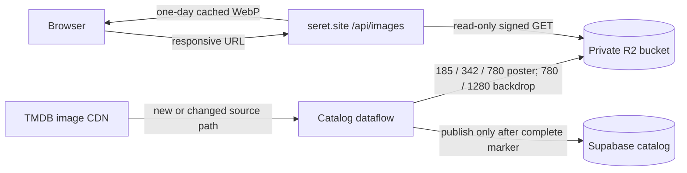

# Catalog artwork in Cloudflare R2

This change mirrors catalog posters and backdrops from TMDB into a private R2 bucket. The app serves the generated WebP variants from `seret.site/api/images/...`; Vercel caches successful responses for one day. Browser `srcset` selection is used for poster cards and wide backdrops. Social preview generation uses the catalog poster and backdrop URLs, so it also reads the mirrored variants.



## Identity and publication

Each object key includes `artwork/v1`, its kind, and the SHA-256 digest of the TMDB file path. A different TMDB path creates a different object set; an unchanged path reuses its completion marker. The marker is written only after every expected variant uploads successfully. The dataflow downloads only the TMDB source size needed for the largest generated variant, validates the response and decoded pixel limit, then uploads the variants. The database URL and `provider_freshness.artwork` metadata are changed only after that marker exists.

The database metadata records the TMDB source path, processing version, published URL, and variant URLs. This supports retries and rollback. Poster and backdrop publication are independent: one can update while the other keeps its last working URL after a failure. Normal now-playing, coming-soon, cinematheque, and individual-update runs all use this path. There is no age-based refresh job. If the TMDB path is unchanged, the pipeline does not redownload the image bytes, so a content replacement made at the same TMDB path is not detected by this strategy.

## Buckets, target selection, and credentials

The separate buckets are `kartiseret-artwork-dev` and `kartiseret-artwork-prod`. Both are private R2 Standard buckets in EEUR, with public `r2.dev` access disabled. Keep each environment's credentials scoped to its own bucket:

| Credential           | Cloudflare token name              | Permission          | Bucket                    |
| -------------------- | ---------------------------------- | ------------------- | ------------------------- |
| Development dataflow | `kartiseret-artwork-dev-dataflow`  | Object Read & Write | `kartiseret-artwork-dev`  |
| Development app      | `kartiseret-artwork-dev-app`       | Object Read only    | `kartiseret-artwork-dev`  |
| Production dataflow  | `kartiseret-artwork-prod-dataflow` | Object Read & Write | `kartiseret-artwork-prod` |
| Production app       | `kartiseret-artwork-prod-app`      | Object Read only    | `kartiseret-artwork-prod` |

Use the bucket-scoped R2 token flow, select the named bucket in its permission policy, and create each token independently. Keep the dataflow access key ID and secret only in server-side local/GitHub secrets. The app receives only the separate read-only key pair. Never use account-wide write permissions or expose credentials through `VITE_*` variables.

### Local scraper and server

The root `.env` uses `DEV_` and `PROD_` profiles. The scraper prompts for the target before it displays the run-plan menu. You can skip the target prompt explicitly:

```sh
python backend/config/runner.py --target development
python backend/config/runner.py --target production
```

`KARTISERET_TARGET=development` or `KARTISERET_TARGET=production` selects a target for scheduled and non-interactive runs. If a local scheduled job has no target, it defaults to production. Do not set `KARTISERET_TARGET` in `.env` if you want an interactive prompt for each scraper run. The selected profile maps to the generic variable names the existing Python code uses, then the supervisor passes only that selected profile to its worker. A Supabase project-ref or R2 bucket mismatch stops the run before a scraper stage begins.

Fill both groups in `.env`:

| Purpose                         | Development prefix                                                                                              | Production prefix                                                        |
| ------------------------------- | --------------------------------------------------------------------------------------------------------------- | ------------------------------------------------------------------------ |
| Supabase API URL                | `DEV_SUPABASE_URL=https://jbydpmjjptwevyijarzl.supabase.co`                                                     | `PROD_SUPABASE_URL=https://gsdrcyrduxbrxgsvhxvr.supabase.co`             |
| Python dataflow service key     | `DEV_SUPABASE_SERVICE_ROLE_KEY`                                                                                 | `PROD_SUPABASE_SERVICE_ROLE_KEY`                                         |
| Publishable API key             | `DEV_SUPABASE_PUBLISHABLE_KEY`                                                                                  | `PROD_SUPABASE_PUBLISHABLE_KEY`                                          |
| Local Node runtime DB URL       | `DEV_DATABASE_URL`                                                                                              | `PROD_DATABASE_URL`                                                      |
| DB CA certificate and pool size | `DEV_DATABASE_SSL_CA_CERT`, `DEV_DATABASE_POOL_MAX`                                                             | `PROD_DATABASE_SSL_CA_CERT`, `PROD_DATABASE_POOL_MAX`                    |
| Optional direct publication DB  | `DEV_PUBLICATION_DATABASE_URL`, `DEV_PUBLICATION_DATABASE_SSL_CA_CERT`                                          | `PROD_PUBLICATION_DATABASE_URL`, `PROD_PUBLICATION_DATABASE_SSL_CA_CERT` |
| R2 writer                       | `DEV_R2_ACCOUNT_ID`, `DEV_R2_BUCKET`, `DEV_R2_IMAGE_ORIGIN`, `DEV_R2_ACCESS_KEY_ID`, `DEV_R2_SECRET_ACCESS_KEY` | Matching `PROD_R2_*` variables                                           |
| R2 app reader                   | `DEV_R2_READ_ACCESS_KEY_ID`, `DEV_R2_READ_SECRET_ACCESS_KEY`                                                    | `PROD_R2_READ_ACCESS_KEY_ID`, `PROD_R2_READ_SECRET_ACCESS_KEY`           |

The target Supabase URLs are fixed to the two project refs above and are checked before use. Copy the publishable key from that project's **Settings → API Keys**. Copy the existing server-side service-role key from that same project; keep it out of the website/browser. For `*_DATABASE_URL`, use the matching Supabase project's runtime database login and connection string (the project ref must appear in the Supavisor username or database host). Copy its database CA certificate from **Database → Settings → SSL Configuration**. The direct publication connection is optional; Python falls back to the Supabase REST RPC when it is empty. `MIGRATION_DATABASE_URL` remains a separate manual operator setting and is deliberately not switched by the scraper selector.

For local artwork writing, set `DEV_R2_IMAGE_ORIGIN` to a stable development app origin whose runtime has the development read-only key. `http://localhost:5173` is useful only for purely local catalog data; do not write that origin into a shared dev catalog. Set `PROD_R2_IMAGE_ORIGIN=https://seret.site`. Leave all five writer values empty if mirroring is disabled; a partial R2 profile fails closed.

The local Node server resolves the same `.env` profiles. With `NODE_ENV=development`, it defaults to the development profile. Select production for a local server explicitly with `KARTISERET_TARGET=production npm run server:dev`. Hosted Vercel environments keep their current generic environment-specific variable names and need no profile prefix.

### GitHub Actions and Vercel

The `Run Main` workflow asks for `development` or `production`, sets `KARTISERET_TARGET` from that dropdown, and maps the matching GitHub Environment values together. In the `development` GitHub Environment, configure `DEV_SUPABASE_URL`, `DEV_SUPABASE_PUBLISHABLE_KEY`, `DEV_SUPABASE_SERVICE_ROLE_KEY`, optional `DEV_PUBLICATION_DATABASE_URL`/`DEV_PUBLICATION_DATABASE_SSL_CA_CERT`, `DEV_R2_ACCOUNT_ID`, `DEV_R2_BUCKET=kartiseret-artwork-dev`, `DEV_R2_IMAGE_ORIGIN`, and the `DEV_R2_ACCESS_KEY_ID`/`DEV_R2_SECRET_ACCESS_KEY` secrets. Keep development notification secrets empty. In the `production` GitHub Environment, use the same names without the `DEV_` prefix and set `R2_BUCKET=kartiseret-artwork-prod`, `R2_IMAGE_ORIGIN=https://seret.site`, production Supabase values, and production-only alert credentials. The workflow environment selection prevents mixing profiles.

For Vercel **Development** and **Preview**, keep the dev `DATABASE_URL` and `DATABASE_SSL_CA_CERT`, and add the dev-only `R2_ACCOUNT_ID`, `R2_BUCKET=kartiseret-artwork-dev`, `R2_READ_ACCESS_KEY_ID`, and `R2_READ_SECRET_ACCESS_KEY`. For Vercel **Production**, keep the production database settings and add the prod bucket/read-only token values with `R2_BUCKET=kartiseret-artwork-prod`. The API endpoint needs only the read-only R2 key; the Supabase service-role key and R2 writer key stay in the dataflow runtime. These are server-only variables. Never put R2 credentials in browser-visible settings.

### Activation order

1. Put the four separate, bucket-scoped R2 key pairs and both Supabase profiles in local `.env`. Keep the production values protected and do not paste secrets into chat.
2. Configure the dev Vercel runtime with the dev Supabase database settings and dev R2 read-only key; deploy the image endpoint. It returns `503` until the read settings are complete.
3. Configure the GitHub `development` Environment and use its Run Main target. Use a controlled development catalog row to exercise one poster and backdrop, verify all variants and completion markers, check the endpoint and responsive UI, and inspect its source metadata. Then run the dev backfill in small resumable batches.
4. Configure production Vercel and GitHub settings separately. Keep production dataflow and backfill untouched during development verification. For rollout, start with a production canary and small batch only after the explicit production deployment decision.

## Backfill and cleanup

The backfill scans `finalMovies`, `finalThequeMovies`, and `finalSoons`. It is idempotent: already-mirrored rows are skipped, and completed R2 objects are reused if a run is repeated. Dry-run is the default.

```sh
# Show which development rows would be migrated (no writes or uploads)
python backend/dataflow/backfill_catalog_artwork.py --backfill --limit 25

# Copy and publish a small development batch
python backend/dataflow/backfill_catalog_artwork.py --backfill --apply --limit 25

# Resume the remaining development catalog
python backend/dataflow/backfill_catalog_artwork.py --backfill --apply
```

Cleanup has a 30-day grace period for recently uploaded objects. It reads every catalog poster/backdrop in all three tables, accounts for shared keys, and skips deletion if its reference scan fails or a dataflow run is active. The operator must pause workflow dispatch/schedules throughout cleanup; the environment flag is an additional assertion, not a distributed lock. First inspect the dry-run candidates, then apply only when the entire dataflow is paused:

```sh
ARTWORK_CLEANUP_PIPELINE_PAUSED=true python backend/dataflow/backfill_catalog_artwork.py --cleanup
ARTWORK_CLEANUP_PIPELINE_PAUSED=true python backend/dataflow/backfill_catalog_artwork.py --cleanup --apply
```

The cleanup script will not infer that an object is unused from age alone. An object remains while any catalog category references it. Never run cleanup during a backfill or while catalog updates can publish references concurrently.

## Monitoring and retry behavior

- Dataflow image download, decode, or upload failures retain the previous URL and emit an `artwork / failed` trace when run summaries are enabled. The next ordinary dataflow run retries the current TMDB path.
- Monitor Vercel `/api/images` 404/502/503 responses and function duration. Errors use `no-store`; successful objects are WebP and cached for one day in browser, Vercel CDN, and downstream CDN caches.
- Compare R2 object count and egress with the number of catalog references. A set should have all expected variants and one completion marker.
- If `provider_freshness.artwork` metadata is missing or malformed, do not run cleanup until the affected rows are repaired or confirmed not to reference R2.

## Rollback

1. Disable R2 writes in the dataflow environment so the next normal run does not republish R2 URLs.
2. Keep the app's R2 read credentials and endpoint deployed while restoring catalog URLs. The rollback reads the TMDB source paths saved in `provider_freshness.artwork` and changes only rows it can safely identify:

   ```sh
   python backend/dataflow/backfill_catalog_artwork.py --rollback
   python backend/dataflow/backfill_catalog_artwork.py --rollback --apply
   ```

   For any future production rollback, the script requires an explicit `--allow-production` alongside `--apply`; that option was not used in this work.

3. Confirm no catalog rows still reference `/api/images/v1/`, then deploy the prior app version or remove the app's R2 read settings. Keep the bucket intact during the rollback window; do not run cleanup as part of rollback.

## TMDB attribution and cache duration

This change does not remove or change the site's existing TMDB attribution. Mirroring should reduce repeated poster/backdrop requests from visitors to TMDB's image CDN; the dataflow fetches image bytes only when a TMDB path first appears, changes, or a required object is missing.

The chosen no-age-refresh policy means an unchanged image can remain in R2 longer than six months even though its TMDB metadata is checked during daily processing. A metadata check is not a refresh of the cached image bytes. TMDB's official FAQ confirms attribution requirements and that commercial use needs a separate license; the official API terms page was blocked to this research session, and I could not confirm how its reported six-month cache limit applies to this exact mirror-and-resize approach. Confirm the current terms or ask TMDB before enabling long-term production mirroring. This implementation does not claim that daily path checks satisfy a cache-age limit.
